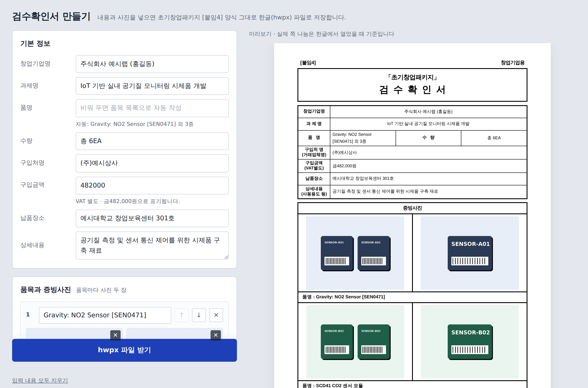

# 검수확인서 만들기 · 초기창업패키지

내용과 증빙사진만 넣으면 **초기창업패키지 [붙임4] 검수확인서**를 원본 양식 그대로 한글(`.hwpx`) 파일로 만들어 주는 웹 도구입니다.

설치나 로그인이 필요 없고, 사진과 입력 내용은 **브라우저 밖으로 나가지 않습니다.**



---

## 왜 만들었나

검수확인서는 구매 건마다 한 장씩 써야 하는데, 매번 한글을 열어 표 칸에 글을 넣고 사진을 하나씩 끼워 넣는 일이 생각보다 오래 걸립니다. 워드나 구글 독스로 옮기면 글꼴과 칸 너비가 틀어져서 결국 한글 양식으로 다시 돌아오게 됩니다.

이 도구는 원본 hwp 양식에서 글꼴, 글자 크기, 문단 모양, 테두리, 표 크기를 그대로 뽑아 두었다가, 입력한 내용만 끼워 넣어 hwpx 파일을 조립합니다. 그래서 결과물이 손으로 채운 양식과 같은 모양으로 나옵니다.

## 할 수 있는 일

| 기능 | 설명 |
| --- | --- |
| 양식 그대로 출력 | 원본 양식의 글꼴(HY헤드라인M, 맑은 고딕), 테두리 굵기, 표 칸 너비를 그대로 씁니다 |
| 품목별 사진 두 장 | 품목마다 전체사진과 상세사진을 넣고, 품목 순서를 위아래로 바꿀 수 있습니다 |
| 실시간 미리보기 | 입력하는 대로 오른쪽에 A4 양식 모양으로 보여 줍니다 |
| 품명 자동 작성 | 품명 칸을 비워 두면 "첫 품목 외 N종"으로 채웁니다 |
| 금액 표기 | `1439420`처럼 숫자만 넣으면 `금1,439,420원`으로 바꿉니다 |
| 날짜 표기 | 고른 날짜를 양식 형식(`2026 년  10 월  7 일`)으로 넣습니다 |
| 사진 용량 줄이기 | 긴 변 1800px이 넘는 사진은 줄여서 JPEG로 넣습니다 |
| 임시 저장 | 입력한 글은 브라우저에 저장되어 다시 열어도 남아 있습니다 (사진은 제외) |
| 쪽 나눔 | 첫 쪽에 2품목, 다음 쪽부터 3품목씩 들어가도록 표를 나눕니다 |

## 사용 방법

1. `index.html`을 브라우저로 엽니다. 파일을 더블클릭하면 되고, 인터넷이 없어도 동작합니다.
2. **기본 정보**에 창업기업명, 과제명, 수량, 구입처, 금액, 납품장소, 상세내용을 입력합니다.
3. **품목과 증빙사진**에서 품명을 쓰고 사진을 눌러 고르거나 끌어다 놓습니다. 품목은 "품목 추가"로 늘립니다.
4. **검수일**을 고릅니다. 기본값은 오늘입니다.
5. **hwpx 파일 받기**를 누르면 `[초기창업패키지] 검수확인서_기업명.hwpx`로 저장됩니다.
6. 한글에서 열어 확인한 뒤 서명란에 날인합니다.

> `.hwp` 파일이 필요하면 한글에서 hwpx 파일을 열고 **다른 이름으로 저장 → 파일 형식: 한글 문서(*.hwp)** 를 고르면 됩니다.

## 개인정보

모든 처리는 내 브라우저 안에서 끝납니다.

- 서버가 없습니다. 입력 내용과 사진은 어디로도 전송되지 않습니다.
- 파일 생성에 필요한 라이브러리(JSZip)도 페이지 안에 들어 있어 외부에서 불러오지 않습니다. 외부 요청은 화면용 웹폰트(Google Fonts)뿐이며, 막혀 있어도 기본 글꼴로 정상 동작합니다.
- 임시 저장은 브라우저의 `localStorage`를 쓰며, "입력 내용 모두 지우기"를 누르면 삭제됩니다.

## 동작 원리

hwpx는 한컴오피스의 개방형 문서 형식(KS X 6101, OWPML)으로, 속은 XML 파일 여러 개를 묶은 ZIP입니다.

```
검수확인서.hwpx (ZIP)
├── mimetype                 ← "application/hwp+zip", 압축 없이 맨 앞에
├── version.xml
├── META-INF/
│   ├── container.xml
│   ├── container.rdf
│   └── manifest.xml
├── Contents/
│   ├── content.hpf          ← 파트 목록, 사진 등록
│   ├── header.xml           ← 글꼴·글자 모양·문단 모양·테두리 (원본 양식에서 추출)
│   └── section0.xml         ← 본문 표와 내용 (입력값으로 생성)
├── BinData/imageN.jpg       ← 증빙사진
├── Preview/PrvText.txt
└── settings.xml
```

1. **양식 스타일 추출 (한 번만).** 원본 hwp 양식을 `pyhwp`로 XML로 풀고, `tools/make_header.py`가 문서 정보(글꼴 61종, 글자 모양 34개, 문단 모양 36개, 테두리 15개, 스타일 51개)를 원본 번호 그대로 `header.xml`로 옮깁니다.
2. **본문 생성 (브라우저에서).** `src/app.html`의 스크립트가 원본 양식과 같은 표 크기(HWPUNIT 단위)와 같은 스타일 번호로 `section0.xml`을 만듭니다. 예를 들어 값이 들어간 칸은 검정 글자 모양(27번), 비어 있는 칸은 원본의 파란 안내 글자 모양(28번)을 씁니다.
3. **포장.** JSZip으로 위 구조의 ZIP을 만들어 내려받습니다. `mimetype`은 규격대로 무압축으로 맨 앞에 둡니다.

## 폴더 구조

```
.
├── index.html               ← 실제로 쓰는 도구 (빌드 산출물, 이 파일 하나로 동작)
├── src/
│   └── app.html             ← 화면·로직 원본 템플릿
├── tools/
│   ├── build.py             ← src/app.html + package/* + JSZip → index.html
│   ├── make_header.py       ← hwp 양식 → header.xml 변환기
│   ├── jszip.min.js         ← JSZip 3.10.1
│   └── package/             ← hwpx 고정 파트 (header.xml 등)
├── docs/screenshot.png
└── .nojekyll
```

## 직접 고쳐서 쓰기

화면이나 동작을 바꾸려면 `src/app.html`을 고친 뒤 다시 빌드합니다. Python 3.8 이상만 있으면 되고 추가 설치는 없습니다.

```bash
python tools/build.py      # → index.html 다시 생성
```

양식 자체가 바뀌었다면 새 양식에서 `header.xml`을 다시 뽑습니다. 표 크기나 칸 구성이 달라졌다면 `src/app.html`의 `buildSection()`도 함께 맞춰야 합니다.

```bash
pip install pyhwp
hwp5proc xml 새양식.hwp > form.xml
python tools/make_header.py form.xml tools/package/header.xml
python tools/build.py
```

## 알려진 한계

- **쪽 나눔은 한글이 정합니다.** 미리보기는 대략적인 모양이고, 품명이나 상세내용이 아주 길면 실제 쪽 나눔이 달라질 수 있습니다.
- **글꼴은 문서에 들어가지 않습니다.** 원본 양식처럼 HY헤드라인M, 맑은 고딕을 참조하므로 그 글꼴이 없는 PC에서는 대체 글꼴로 보입니다.
- **hwpx를 지원하는 한글(2014 이후 버전)**이 필요합니다. 다른 프로그램의 hwpx 지원은 제한적입니다.
- **서명은 직접 해야 합니다.** 검수인 날인란은 비워 둡니다.
- 입력 내용 임시 저장에 사진은 포함되지 않습니다.

## 감사의 말

이 도구는 **[Canine89](https://github.com/Canine89)** 님의 **[gonggong_hwpxskills](https://github.com/Canine89/gonggong_hwpxskills)** 저장소에서 출발했습니다. 공공기관 보고서·공문을 hwpx로 다루는 방법을 정리해 공개해 주신 덕분에 처음 방향을 잡을 수 있었습니다.

특히 이런 부분에서 큰 도움을 받았습니다.

- hwpx가 ZIP 안에 XML 파트를 묶은 구조라는 점과, 각 파트(`content.hpf`, `header.xml`, `section0.xml`)가 맡는 역할 정리
- 처음부터 문서를 그리지 않고 **잘 만든 양식을 바탕으로 내용을 채운다**는 접근 방식
- XML 네임스페이스 프리픽스를 한컴 표준(`hh`, `hc`, `hp`, `hs`)으로 맞춰야 한글에서 빈 페이지로 보이지 않는다는 점

`tools/package/`의 `version.xml`, `container.xml`, `container.rdf`, `manifest.xml`은 이 저장소의 보고서 양식에 들어 있던 파일을 그대로 가져왔습니다. 좋은 자료를 나눠 주셔서 감사합니다.

## 라이선스

- 이 저장소의 코드: [MIT License](LICENSE)
- [JSZip](https://stuk.github.io/jszip/) 3.10.1: MIT 또는 GPLv3 (듀얼 라이선스), 저작권 고지는 `tools/jszip.min.js` 머리말에 있습니다.
- 검수확인서 양식은 초기창업패키지 사업 공고의 첨부 서식이며, 이 도구는 그 서식을 채우는 보조 도구입니다. 사업 운영 기관과 관련이 없습니다.
